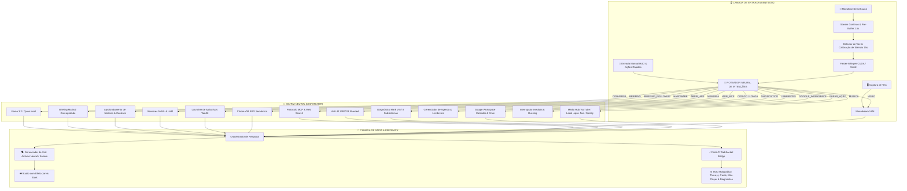

# ⚡ JARVIS - Núcleo de Inteligência Artificial Local & Sensorial
### 🏛️ STARK INDUSTRIES ARCHITECTURE | VERSÃO ALPHA 0.06

<div align="center">


<p align="center">
  <b>Um assistente pessoal inteligente, autônomo, 100% privado e local, inspirado no J.A.R.V.I.S. da ficção.</b><br>
  Equipado com audição contínua em tempo real, voz neural estilizada, visão computacional de tela, memória vetorial semântica de longo prazo, telemetria física de hardware, briefing matinal holográfico coreografado, diagnóstico completo Mark VII, Media Hub com suporte a áudio lossless e interface 3D interativa.
</p>

</div>

---

## 🌌 A Ideia & Filosofia do Projeto

A maioria dos assistentes comerciais modernos sofre de três problemas fundamentais:
1. **Dependência Crítica da Nuvem**: Seus dados de voz, tela e perguntas pessoais são enviados para servidores de terceiros.
2. **Latência de Comunicação**: O tempo de espera entre você falar e o robô responder quebra a ilusão de uma conversa natural.
3. **Exigência de Supercomputadores para Modelos Grandes**: Modelos potentes de 32B ou 70B normalmente exigem estações industriais com dezenas de gigabytes de VRAM.

### 💡 A Solução do JARVIS Core:
O **JARVIS** foi arquitetado do zero para contornar esses gargalos com soluções de engenharia avançadas:
- **100% Local & Privado**: Nenhuma conversa, imagem da sua tela ou dado biométrico de voz sai da sua máquina.
- **Roteamento Neural Híbrido**: Respostas instantâneas para comandos comuns através de caminhos rápidos em Python/Regex e especialistas neurais dedicados para tarefas profundas.
- **Auto-Calibração de Hardware**: Identifica dinamicamente sua CPU, memória RAM e VRAM dedicada, ajustando o perfil operacional desde placas modestas (4 GB VRAM) até sistemas topo de linha.
- **Inferência Sharded (AirLLM)**: Capacidade de fatiar e rodar modelos massivos (como `Qwen 32B` e `72B`) camada por camada na memória secundária (SSD/HD), permitindo raciocínio de alta precisão em placas gráficas comuns.
- **HUD Holográfico Stark**: Apresentação visual cinematográfica com Three.js, cards translúcidos de vidro (Glassmorphism), animações FLIP e transição suave da esfera neural para o modo Mini-Core.
- **Ecossistema de Integrações MCP & Workspace**: Integração com Google Calendar e Google Drive com OAuth2 nativo, além de controle multimídia e diagnóstico autônomo de subsistemas.

---

## 🏛️ Arquitetura do Sistema



---

## 🚀 Funcionalidades Principais & Diferenciais Únicos

### 1. 📡 Briefing Matinal Coreografado & Radar Executivo (Novidade)
- **Varredura Multimodal Matinal**: Coleta simultânea e ultrarrápida de 7 pilares essenciais:
  1. **Meteorologia Local**: Temperatura atual, sensação térmica, umidade, vento e condições climáticas (`wttr.in`).
  2. **Agenda & Lembretes Pessoais**: Compromissos diários pendentes integrados à gaveta de lembretes.
  3. **Mercado Financeiro em Tempo Real**: Cotações de Dólar, Euro e Bitcoin (AwesomeAPI) + fechamentos de Ibovespa (B3) e S&P 500 (Yahoo Finance).
  4. **Radar Internacional & EUA**: Matérias apuradas em tempo real com imagens reais (BBC News Brasil / G1 Mundo).
  5. **Radar Economia & Negócios**: Notícias e análises de mercado (G1 Economia / InfoMoney).
  6. **Radar Tecnologia & Inteligência Artificial**: Últimos avanços em IA e inovação (G1 Tecnologia / TecMundo).
  7. **Radar Política & Brasil**: Panorama dos três poderes e cenário nacional (G1 Política).
- **Coreografia Sincronizada TTS + Visual**: O Jarvis apresenta cada card no centro da tela enquanto a esfera neural 3D encolhe suavemente para o canto superior esquerdo (**Modo Mini-Core**). Ao concluir a fala de um tópico, o card desliza e se ancora no **Dock Inferior Flutuante** via animação FLIP (*First, Last, Invert, Play*).
- **Persistência Completa na Memória**: O briefing é salvo imediatamente tanto na memória de curto prazo (`memory_short`) quanto na memória vetorial (`memory_long` - ChromaDB).
- **Aprofundamento de Notícias (Follow-up Inteligente)**: Ao perguntar *"Jarvis, me fale mais sobre esse assunto que o governo aprova"* ou *"me dê detalhes da notícia de tecnologia"*, o assistente localiza o card em cache, analisa o texto completo da matéria (ou faz fetch do link via `mcp_client.obter_conteudo_url`) e oferece uma análise aprofundada e fluida.
- **Card Expandido com Rolagem Livre e Botões**:
  - Área rolável estilizada `.card-scrollable-body` com scroll suave pelo mouse wheel.
  - **`🔊 Ouvir Detalhes`**: Solicita ao Jarvis que leia a íntegra da matéria em voz alta.
  - **`🌐 Ler na Fonte ↗`**: Abre a matéria original diretamente na fonte em uma nova aba do navegador.

### 2. 👂 Audição Contínua em Tempo Real & Detector de Silêncio Aprimorado
- **Driver DirectSound Dedicado**: O Jarvis seleciona nativamente o driver DirectSound do Windows (`hostapi=1`), garantindo ganho de sinal até 10x maior que os drivers MME convencionais.
- **Pré-Buffer Circular Persistente (1.5s)**: Um buffer rotativo guarda os últimos 1.5 segundos de som. Quando você começa a falar, a primeira sílaba nunca é cortada.
- **Calibração Adaptativa de Ruído & Fim de Fala Rápido**: O teto de fala foi expandido para **15 segundos** (`MAX_DURACAO_FALA = 15.0s`), e o detector de silêncio encerra a gravação após 16 frames (~1.0s) de silêncio sustentado, agilizando o envio para a transcrição Whisper CUDA.
- **Controle Manual Instantâneo**: Botão **`[ ⏹️ PARAR E ENVIAR ]`** no HUD para interrupção forçada imediata.

### 3. 🗣️ Síntese Vocal Dupla (Modo Stark Neural & Kokoro Offline)
- **Voz Padrão Oficial**: `pt-BR-AntonioNeural` (Edge-TTS) com Zero consumo de CPU/GPU, latência instantânea e filtro sonoro de modulação de voz (estilo rádio/sci-fi Stark).
- **Fallback Automático Kokoro**: Em caso de oscilação ou ausência de internet, o sistema comuta instantaneamente para o modelo local `Kokoro-TTS` (`blend_jarvis` / `pm_alex`), garantindo operação 100% ininterrupta.
- **Filtro Anti-Eco**: Higienização automática do buffer do microfone após cada fala (`limpar_pre_buffer()`), impedindo que o assistente escute a própria voz nos alto-falantes.

### 4. 🌐 Interface Holográfica 3D & HUD Reativo (Three.js)
- **Núcleo Neural 3D Procedural**: Esfera reativa inspirada no reator arc com pulsação física e deformação por ruído simplex de acordo com a voz e tarefa.
- **Modo Mini-Core no Canto**: Sempre que houver cards ou conteúdo visual em destaque no centro, a esfera migra para o canto superior esquerdo e diminui sua escala, mantendo o palco livre para leitura e interação.
- **Dock de Vidro Translúcido**: Fileira inferior sem bordas pesadas, exibindo mini-cards de vidro flutuantes com miniaturas reais e botões de expansão rápida.
- **Gaveta Lateral de Lembretes**: Sistema de tarefas com horários, marcação de conclusão e modal rápido para inclusão de novos lembretes (`DADOS/lembretes.json`).

### 5. 🧠 Memória Semântica de Longo Prazo (ChromaDB RAG)
- O Jarvis mantém consciência temporal entre sessões.
- **Coleção de Fatos**: Preferências, nomes, segredos, hábitos e credenciais locais.
- **Histórico Conversacional**: Contexto vetorial contínuo pesquisado por similaridade de cosseno, garantindo que conversas passadas e briefings matinais sejam lembrados a qualquer momento.

### 6. 🛡️ Sentinela Térmico & Telemetria Físico-Digital
- Monitoramento contínuo da GPU via **NVIDIA NVML** (temperatura, consumo em Watts, uso de VRAM) e sensores da CPU/placa-mãe via **LibreHardwareMonitor**.
- Alertas por voz prioritários caso os componentes atinjam limites térmicos críticos.

### 7. 👁️ Olhos no Desktop (Visão Computacional)
- Integração com o modelo multimodal **Moondream (VLM)**.
- Capturas invisíveis sob demanda para inspeção de erros no código, leitura de telas e auxílio operacional.

### 8. 🩺 Diagnóstico Completo de Sistemas // Mark VII (HUD Holográfico em Tempo Real)
- **Checkup Profundo e Multithread**: Teste em tempo real dos 8 subsistemas vitais do Jarvis com medição de latência em milissegundos:
  1. **Núcleo Neural & Roteador (Ollama)**: Verificação da porta 11434 e modelos ativos (`llama3.2:3b` e `qwen`).
  2. **Módulo de Visão (Moondream)**: Teste de prontidão do VLM e integridade da captura de tela (`mss`/`PIL`).
  3. **Memória Semântica (ChromaDB)**: Varredura vetorial e contagem de fatos persistentes e memórias conversacionais.
  4. **Sintetizador & Audição**: Checagem do microfone ativo e conexão neural Edge-TTS / Whisper CUDA.
  5. **Google Calendar API**: Verificação de token OAuth2 e consulta em tempo real à agenda do usuário.
  6. **Google Drive API**: Teste de conexão ao Workspace e acesso a documentos e arquivos recentes.
  7. **Rede & Media Hub**: Verificação de conectividade externa, `yt-dlp` e varredura do acervo local em `MUSICAS_LOCAIS`.
  8. **Sentinela de Hardware (GPU & CPU)**: Leitura de uso, clock, temperatura e VRAM da GTX 1650 e CPU Ryzen 5 via `pynvml` e `psutil`.
- **HUD Holográfico Glassmorphism**: Card central translúcido com animação de scan laser, badges dinâmicos (`TESTANDO`, `OPERACIONAL`, `ALERTA`, `FALHA`), tempos de resposta (`ms`) e barra de progresso.
- **Transição de Esfera para Mini-Core**: O núcleo 3D migra suavemente para o canto superior esquerdo (`.canvas-mini-corner`) liberando o centro para a leitura dos diagnósticos.
- **Síntese Vocal Executiva**: Ao concluir a varredura, o Jarvis relata por voz um panorama conciso do status operacional.
- **Acionamento Híbrido**: Disponível por comando de voz (*"Jarvis, faça um diagnóstico"*, *"verificar todos os sistemas"*) ou pelo menu `⚙️ SISTEMA` (`#sys-dropdown`). Inclui botão `✕ Fechar` e recolhimento automático após 45 segundos.

### 9. 🔗 Integração Google Workspace MCP (Google Calendar & Google Drive)
- **Autenticação OAuth2 Nativa**: Fluxo seguro via Google Cloud Console sem expor credenciais no código-fonte.
- **Agenda Unificada**: Consulta simultânea da agenda do Google Calendar e dos lembretes locais pendentes, sintetizando uma resposta integrada por voz (*"Dá uma olhada na minha agenda"*).
- **Busca Inteligente no Google Drive**: Detecção automática de consultas genéricas ou pedidos de teste (ex: *"Liste alguns arquivos aleatórios que estão no meu Google Drive"*), trazendo os arquivos mais recentes reais (`modifiedTime desc`) sem filtros restritivos que gerem falso negativo. Se houver um nome específico, limpa stopwords antes de aplicar `name contains`.

### 10. 🎵 Media Hub Sci-Fi & Mini-Player Holográfico Arrastável
- **Player HUD Multimídia**: Widget flutuante, translúcido e arrastável pelo usuário (`.player-hud-floating`), com controle de volume, scrubbing na barra de progresso, botões Play/Pause, Próxima e Anterior.
- **Multi-Fontes de Áudio**: Suporte integrado a **YouTube** (busca e streaming direto via `yt-dlp`), **Spotify** (integração via Windows URI e MCP) e **Músicas Offline do PC**.
- **Suporte Nativo a Áudio Lossless (`.opus` e `.flac`)**: Leitura completa de pastas locais, com higienização automática de títulos (remoção de IDs do YouTube entre colchetes como `[lbehxlFIlpc]`) e transcodificação transparente em cache (`TEMP_AUDIO/converted_current.mp3`) via `ffmpeg`.
- **Áudio Ducking Inteligente**: Redução automática e suave do volume da música sempre que o microfone abre ou o Jarvis começa a falar, restaurando o volume padrão logo após.

### 11. ⏹️ Parada Imediata Universal & Controle de Ação
- **Botão Universal `[ ⏹️ PARAR FALA / AÇÃO ]`**: Localizado no dock inferior para interromper instantaneamente qualquer fala ativa, esvaziar a fila de áudio do `pygame.mixer` e abortar ações em segundo plano.
- **Gatilhos Vocais de Emergência**: O Jarvis interrompe imediatamente sua fala ao detectar comandos prioritários como *"Jarvis, pare"*, *"silêncio"*, *"calado"* ou *"cancelar"*.

### 12. 🔒 Blindagem de Privacidade, Dados Pessoais & Credenciais
- **Proteção Total contra Vazamento no Git**: `.gitignore` estruturado em 8 camadas blindando tokens OAuth2 (`google_token.json`), credenciais do Google Cloud (`google_credentials.json`), lembretes pessoais (`lembretes.json`), identidade do PC (`jarvis_identity.json`), briefings antigos (`ultimo_briefing.json`) e centenas de arquivos de mídia (`MUSICAS_LOCAIS/*`, `TEMP_AUDIO/*`).
- **Templates Seguros `.example`**: Inclusão de arquivos de modelo sem dados reais (`google_credentials.json.example` e `lembretes.json.example`) para que novos desenvolvedores configurem o projeto sem riscos.
- **Empacotador Higienizado**: O script `empacotar.py` conta com filtros de segurança ativos para impedir que qualquer arquivo com tokens, chaves ou credenciais seja incluído no `CONTEXTO_JARVIS.md`.

---

## 📂 Estrutura do Repositório

```plaintext
Meu_agente_de_IA/
├── DADOS/                        # Persistência de banco de dados e configs locais
│   ├── google_credentials.json.example # Template de credenciais Google OAuth2
│   ├── lembretes.json.example    # Template de banco de dados de agenda
│   ├── config_paths.json         # Diretórios configurados de SSD e HD
│   ├── model_registry.json       # Registro de especialistas e perfis de hardware
│   ├── news_config.json          # Configuração de temas e cidade do briefing
│   ├── voice_config.json         # Configuração de voz e motor de síntese
│   └── mcp_servers.json          # Configurações de servidores Model Context Protocol
├── INTERFACE/                    # Frontend holográfico e servidor visual
│   ├── index.html                # Visualizador Three.js, Stage de Diagnóstico e HUD
│   ├── style.css                 # Estilização sci-fi glassmorphism, scroll e Mini-Core
│   └── app.js                    # Motor Three.js, coreografia de cards, Mini-Player e WebSocket
├── MODULOS/                      # Núcleo modular do agente
│   ├── brain/                    # Tomada de decisão, conversação e RAG
│   │   ├── core/router.py        # Roteador neural de intenções (Diagnóstico, Agenda, Música, etc.)
│   │   ├── core/conversation.py  # Gerador de diálogo contextual enriquecido
│   │   ├── memory/handler.py     # Classificador semântico de memórias
│   │   └── selector/             # Seletor automático de perfil de hardware
│   ├── ear/                      # Audição e transcrição
│   │   ├── recorder.py           # Captura DirectSound com 15s de teto e VAD rápido
│   │   ├── transcriber.py        # Faster-Whisper Small CUDA
│   │   └── states.py             # Máquina de estados do microfone
│   ├── voice/                    # Síntese vocal
│   │   ├── voice_manager.py      # Gestor de voz (Antonio Neural padrão + Kokoro fallback)
│   │   ├── kokoro_tts_module.py  # Síntese neural local Kokoro (pt-BR)
│   │   └── audio_effects.py      # Efeitos de modulação vocal Jarvis
│   ├── skills/                   # Habilidades ativas
│   │   ├── diagnostics_module.py # Diagnóstico completo de 8 subsistemas em tempo real
│   │   ├── google_mcp_module.py  # Integração Google Calendar & Drive API (OAuth2)
│   │   ├── music_module.py       # Media Hub (YouTube, Spotify e Offline .opus/.flac)
│   │   ├── pc_control_module.py  # Controles de volume, clipboard e sistema
│   │   ├── briefing_module.py    # Motor do Briefing Matinal, scraping e follow-up
│   │   ├── reminders_module.py   # Gerenciador de agenda unificada e lembretes
│   │   ├── hardware_module.py    # Sensores de hardware (NVML/LHM)
│   │   ├── vision_module.py      # Análise de tela via Moondream
│   │   ├── actions_module.py     # Execução de comandos e apps do Windows
│   │   ├── fii_monitor.py        # Monitor de mercado financeiro
│   │   └── mcp_client.py         # Cliente MCP para internet, cotações e web fetch
│   ├── memory/                   # Banco vetorial ChromaDB persistente
│   └── system/                   # Infraestrutura, logs e sincronização
├── MUSICAS_LOCAIS/               # Acervo local de músicas (.opus, .flac, .mp3, etc.)
├── TESTES/                       # Suíte de testes unitários e diagnósticos
├── main.py                       # Orquestrador mestre e loop de vida do Jarvis
├── empacotar.py                  # Script para empacotamento seguro em CONTEXTO_JARVIS.md
├── requirements.txt              # Dependências do ecossistema
└── README.md                     # Documentação oficial do projeto
```

---

## 🛠️ Como Instalar e Rodar

### 📋 Pré-requisitos
- **Sistema Operacional**: Windows 10 ou 11 (64-bit).
- **Python**: Versão `3.11.x` recomendada.
- **Ollama**: Instalado e rodando localmente ([ollama.com](https://ollama.com)).
  - Baixe os modelos recomendados no terminal:
    ```bash
    ollama pull llama3.2:3b
    ollama pull qwen2.5:1.5b
    ollama pull moondream
    ```
- **Placa de Vídeo**: Recomendado GPU NVIDIA com drivers CUDA atualizados (opera também via CPU com quantização).

### ⚙️ Instalação Passo a Passo

1. **Clone o repositório:**
   ```bash
   git clone https://github.com/Felipe-Roberto-Bacchi/Meu_agente_de_IA.git
   cd Meu_agente_de_IA
   ```

2. **Crie e ative um ambiente virtual (recomendado):**
   ```bash
   python -m venv venv
   .\venv\Scripts\activate
   ```

3. **Instale as dependências:**
   ```bash
   pip install -r requirements.txt
   ```

4. **Inicie o JARVIS:**
   ```bash
   python main.py
   ```

5. **Acesso à Interface:**
   - O assistente abrirá automaticamente a interface holográfica no seu navegador padrão em:
     **`http://localhost:8000`**

---

## 🗣️ Exemplos de Comandos (Voz ou Texto)

| Objetivo | O que você pode dizer ou digitar | O que o Jarvis faz |
| :--- | :--- | :--- |
| **Diagnóstico Mark VII** | *"Jarvis, faça um diagnóstico"* ou *"verificar todos os sistemas"* | Executa o checkup em tempo real dos 8 subsistemas com telemetria no HUD e síntese por voz. |
| **Briefing Matinal** | *"Jarvis, bom dia"* ou *"iniciar briefing matinal"* | Executa a telemetria matinal completa com desfile sincronizado de cards e voz. |
| **Aprofundamento de Notícia** | *"Me fale mais sobre esse assunto que o governo aprova"* | Localiza a notícia do briefing em cache, lê os dados do artigo e detalha os desdobramentos. |
| **Agenda Unificada** | *"Dá uma olhada na minha agenda"* ou *"tenho compromisso pra hoje?"* | Consulta simultaneamente o Google Calendar e os lembretes locais pendentes. |
| **Lembretes Pessoais** | *"Me lembre de enviar o relatório às 16:30"* | Registra a tarefa na agenda e exibe na gaveta lateral do HUD. |
| **Google Drive** | *"Liste alguns arquivos aleatórios que estão no meu Google Drive"* | Lista os arquivos reais mais recentes modificados no seu Google Drive. |
| **Media Hub & Música** | *"Toque um lofi no YouTube"* ou *"toca uma música offline"* | Inicia a reprodução no Mini-Player flutuante com suporte a `.opus`, `.flac` e YouTube. |
| **Controle de Mídia** | *"Próxima música"*, *"pausar música"*, *"volume em 80"* | Controla a playlist, altera o volume e alterna fontes no player arrastável. |
| **Parada Imediata** | *"Jarvis, pare"*, *"silêncio"* ou clique em **`[ ⏹️ PARAR FALA / AÇÃO ]`** | Corta instantaneamente a fala ativa e esvazia a fila de áudio do sistema. |
| **Conversa Geral** | *"Olá Jarvis, como estão seus sistemas hoje?"* | Gera uma resposta natural contextualizada via Llama 3.2. |
| **Telemetria de PC** | *"Como estão as temperaturas da máquina?"* | Lê os sensores da GPU (NVML) e CPU em tempo real e relata graus e consumo. |
| **Visão de Tela** | *"Dá uma olhada na minha tela e me diga o que vê."* | Tira um snapshot invisível e analisa o conteúdo via Moondream VLM. |
| **Memória Contínua** | *"Jarvis, lembre que a senha do alarme é 4092."* | Grava o fato semanticamente no ChromaDB para uso futuro. |
| **Resgate de Fato** | *"Você sabe qual é a senha do alarme?"* | Realiza uma busca vetorial nas suas memórias e responde precisamente. |
| **Mercado Financeiro** | *"Como está o mercado financeiro hoje?"* | Consulta cotações de Dólar, Euro, Bitcoin, Ibovespa e S&P 500 em tempo real. |
| **Abrir Aplicativos** | *"Abre o Spotify para mim."* | Localiza o executável em cache e inicia o programa no Windows. |

---

## 📌 Histórico de Versões & Marcos Recentes

- **v0.01 (Nascimento do Núcleo)**:
  - Estruturação da arquitetura modular, ChromaDB e loop básico com Whisper.
- **v0.02 (Multimodalidade & Three.js)**:
  - Adição do analisador visual Moondream, servidor FastAPI e visualizador 3D reativo.
- **v0.03 (Estabilidade de Áudio & HUD)**:
  - Integração do driver DirectSound, dock de controle com botão neon e higienização de eco.
- **v0.04 (Voz Neural Stark & Lembretes)**:
  - Adoção da voz `pt-BR-AntonioNeural` (Edge-TTS) com fallback offline para Kokoro-TTS.
  - Implementação do módulo de lembretes e agenda persistente no HUD.
- **v0.05 (Briefing Holográfico & Follow-up Neural)**:
  - 📡 **Briefing Matinal Coreografado**: Apresentação de 7 cards multimídia (Clima, Agenda, Mercado, 4 Notícias) com animações FLIP e transição de esfera para Mini-Core.
  - 📰 **Scraping Profundo de Matérias**: Extração assíncrona do texto integral de artigos e imagens reais `og:image` de fontes de notícias abertas.
  - 🧠 **Memória & Rota de Aprofundamento**: Registro automático do briefing em memória de curto e longo prazo, permitindo perguntas de acompanhamento imediatas com resposta aprofundada via LLM.
  - 🖱️ **UI/UX com Rolagem Livre e Interação**: Correção de overflow no CSS, scrollbar ciano estilizada e botões interativos para ouvir matérias e ler na fonte original.
  - 🎤 **Audição Calibrada para 15s**: Ampliação da janela de fala e encerramento dinâmico por silêncio após 16 frames (~1s).
- **v0.06 - Versão Atual (Alpha 0.06: Mark VII - Diagnóstico, Google Workspace, Media Hub & Blindagem)**:
  - 🩺 **Diagnóstico de Sistemas em Tempo Real (Mark VII)**: Checkup profundo de 8 subsistemas vitais (Ollama, Moondream, ChromaDB, Whisper/TTS, Calendar, Drive, Media Hub e Hardware) com medição de latência em milissegundos, HUD holográfico Glassmorphism com animação de scan laser, badges de integridade dinâmicos e síntese vocal executiva.
  - 🔗 **Google Workspace MCP Integrado**: Integração com Google Calendar e Google Drive API via OAuth2, consulta de agenda unificada e busca inteligente no Drive com suporte a arquivos recentes reais sem filtros restritivos.
  - 🎵 **Media Hub Completo & Player Holográfico Arrastável**: Mini-player flutuante com scrubber, suporte nativo a `.opus` e `.flac` locais com higienização de IDs do YouTube entre colchetes, streaming do YouTube e Spotify, além de Áudio Ducking inteligente.
  - ⏹️ **Controle Universal de Parada Imediata**: Botão `[ ⏹️ PARAR FALA / AÇÃO ]` e comandos vocais prioritários (*"Jarvis, pare"*, *"silêncio"*, *"cancelar"*).
  - 🔒 **Blindagem de Segurança & Privacidade**: `.gitignore` completo em 8 camadas protegendo tokens OAuth2, segredos GCP, histórico pessoal e mídias, além de templates `.example` e higienização em `empacotar.py`.

---

## 👨‍💻 Autor & Direitos

Desenvolvido com dedicação por **Felipe Roberto Bacchi**.  
Inspirado na ficção científica, na engenharia de computação moderna e na busca por uma inteligência artificial verdadeiramente livre, útil e pessoal.

---

<div align="center">
  <i>"Às vezes, é preciso correr antes de conseguir andar." — Tony Stark</i>
</div>

