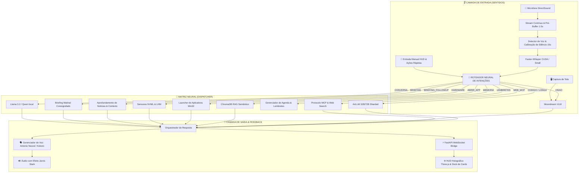

# ⚡ JARVIS - Núcleo de Inteligência Artificial Local & Sensorial
### 🏛️ STARK INDUSTRIES ARCHITECTURE | VERSÃO ALPHA 0.05

<div align="center">


<p align="center">
  <b>Um assistente pessoal inteligente, autônomo, 100% privado e local, inspirado no J.A.R.V.I.S. da ficção.</b><br>
  Equipado com audição contínua em tempo real, voz neural estilizada, visão computacional de tela, memória vetorial semântica de longo prazo, telemetria física de hardware, briefing matinal holográfico coreografado e interface 3D interativa.
</p>

</div>

---

## 🌌 A Ideia & Filosofia do Projeto

A maioria dos assistentes comerciais modernos sofre de três problemas fundamentais:
1. **Dependência Crítica da Nuvem**: Seus dados de voz, tela e perguntas pessoais são enviados para servidores de terceiros.
2. **Latência de Comunicação**: O tempo de espera entre você falar e o robô responder quebra a ilusão de uma conversa natural.
3. **Exigência de Supercomputadores para Modelos Grandes**: Modelos potentes de 32B ou 70B normalmente exigem estações industriais com dezenas de gigabytes de VRAM.

### 💡 A Solução do JARVIS Core:
O **JARVIS** foi arquitetado do zero para contornar esses gargalos com soluções de engenharia avançadas:
- **100% Local & Privado**: Nenhuma conversa, imagem da sua tela ou dado biométrico de voz sai da sua máquina.
- **Roteamento Neural Híbrido**: Respostas instantâneas para comandos comuns através de caminhos rápidos em Python/Regex e especialistas neurais dedicados para tarefas profundas.
- **Auto-Calibração de Hardware**: Identifica dinamicamente sua CPU, memória RAM e VRAM dedicada, ajustando o perfil operacional desde placas modestas (4 GB VRAM) até sistemas topo de linha.
- **Inferência Sharded (AirLLM)**: Capacidade de fatiar e rodar modelos massivos (como `Qwen 32B` e `72B`) camada por camada na memória secundária (SSD/HD), permitindo raciocínio de alta precisão em placas gráficas comuns.
- **HUD Holográfico Stark**: Apresentação visual cinematográfica com Three.js, cards translúcidos de vidro (Glassmorphism), animações FLIP e transição suave da esfera neural para o modo Mini-Core.

---

## 🏛️ Arquitetura do Sistema



---

## 🚀 Funcionalidades Principais & Diferenciais Únicos

### 1. 📡 Briefing Matinal Coreografado & Radar Executivo (Novidade)
- **Varredura Multimodal Matinal**: Coleta simultânea e ultrarrápida de 7 pilares essenciais:
  1. **Meteorologia Local**: Temperatura atual, sensação térmica, umidade, vento e condições climáticas (`wttr.in`).
  2. **Agenda & Lembretes Pessoais**: Compromissos diários pendentes integrados à gaveta de lembretes.
  3. **Mercado Financeiro em Tempo Real**: Cotações de Dólar, Euro e Bitcoin (AwesomeAPI) + fechamentos de Ibovespa (B3) e S&P 500 (Yahoo Finance).
  4. **Radar Internacional & EUA**: Matérias apuradas em tempo real com imagens reais (BBC News Brasil / G1 Mundo).
  5. **Radar Economia & Negócios**: Notícias e análises de mercado (G1 Economia / InfoMoney).
  6. **Radar Tecnologia & Inteligência Artificial**: Últimos avanços em IA e inovação (G1 Tecnologia / TecMundo).
  7. **Radar Política & Brasil**: Panorama dos três poderes e cenário nacional (G1 Política).
- **Coreografia Sincronizada TTS + Visual**: O Jarvis apresenta cada card no centro da tela enquanto a esfera neural 3D encolhe suavemente para o canto superior esquerdo (**Modo Mini-Core**). Ao concluir a fala de um tópico, o card desliza e se ancora no **Dock Inferior Flutuante** via animação FLIP (*First, Last, Invert, Play*).
- **Persistência Completa na Memória**: O briefing é salvo imediatamente tanto na memória de curto prazo (`memory_short`) quanto na memória vetorial (`memory_long` - ChromaDB).
- **Aprofundamento de Notícias (Follow-up Inteligente)**: Ao perguntar *"Jarvis, me fale mais sobre esse assunto que o governo aprova"* ou *"me dê detalhes da notícia de tecnologia"*, o assistente localiza o card em cache, analisa o texto completo da matéria (ou faz fetch do link via `mcp_client.obter_conteudo_url`) e oferece uma análise aprofundada e fluida.
- **Card Expandido com Rolagem Livre e Botões**:
  - Área rolável estilizada `.card-scrollable-body` com scroll suave pelo mouse wheel.
  - **`🔊 Ouvir Detalhes`**: Solicita ao Jarvis que leia a íntegra da matéria em voz alta.
  - **`🌐 Ler na Fonte ↗`**: Abre a matéria original diretamente na fonte em uma nova aba do navegador.

### 2. 👂 Audição Contínua em Tempo Real & Detector de Silêncio Aprimorado
- **Driver DirectSound Dedicado**: O Jarvis seleciona nativamente o driver DirectSound do Windows (`hostapi=1`), garantindo ganho de sinal até 10x maior que os drivers MME convencionais.
- **Pré-Buffer Circular Persistente (1.5s)**: Um buffer rotativo guarda os últimos 1.5 segundos de som. Quando você começa a falar, a primeira sílaba nunca é cortada.
- **Calibração Adaptativa de Ruído & Fim de Fala Rápido**: O teto de fala foi expandido para **15 segundos** (`MAX_DURACAO_FALA = 15.0s`), e o detector de silêncio encerra a gravação após 16 frames (~1.0s) de silêncio sustentado, agilizando o envio para a transcrição Whisper CUDA.
- **Controle Manual Instantâneo**: Botão **`[ ⏹️ PARAR E ENVIAR ]`** no HUD para interrupção forçada imediata.

### 3. 🗣️ Síntese Vocal Dupla (Modo Stark Neural & Kokoro Offline)
- **Voz Padrão Oficial**: `pt-BR-AntonioNeural` (Edge-TTS) com Zero consumo de CPU/GPU, latência instantânea e filtro sonoro de modulação de voz (estilo rádio/sci-fi Stark).
- **Fallback Automático Kokoro**: Em caso de oscilação ou ausência de internet, o sistema comuta instantaneamente para o modelo local `Kokoro-TTS` (`blend_jarvis` / `pm_alex`), garantindo operação 100% ininterrupta.
- **Filtro Anti-Eco**: Higienização automática do buffer do microfone após cada fala (`limpar_pre_buffer()`), impedindo que o assistente escute a própria voz nos alto-falantes.

### 4. 🌐 Interface Holográfica 3D & HUD Reativo (Three.js)
- **Núcleo Neural 3D Procedural**: Esfera reativa inspirada no reator arc com pulsação física e deformação por ruído simplex de acordo com a voz e tarefa.
- **Modo Mini-Core no Canto**: Sempre que houver cards ou conteúdo visual em destaque no centro, a esfera migra para o canto superior esquerdo e diminui sua escala, mantendo o palco livre para leitura e interação.
- **Dock de Vidro Translúcido**: Fileira inferior sem bordas pesadas, exibindo mini-cards de vidro flutuantes com miniaturas reais e botões de expansão rápida.
- **Gaveta Lateral de Lembretes**: Sistema de tarefas com horários, marcação de conclusão e modal rápido para inclusão de novos lembretes (`DADOS/lembretes.json`).

### 5. 🧠 Memória Semântica de Longo Prazo (ChromaDB RAG)
- O Jarvis mantém consciência temporal entre sessões.
- **Coleção de Fatos**: Preferências, nomes, segredos, hábitos e credenciais locais.
- **Histórico Conversacional**: Contexto vetorial contínuo pesquisado por similaridade de cosseno, garantindo que conversas passadas e briefings matinais sejam lembrados a qualquer momento.

### 6. 🛡️ Sentinela Térmico & Telemetria Físico-Digital
- Monitoramento contínuo da GPU via **NVIDIA NVML** (temperatura, consumo em Watts, uso de VRAM) e sensores da CPU/placa-mãe via **LibreHardwareMonitor**.
- Alertas por voz prioritários caso os componentes atinjam limites térmicos críticos.

### 7. 👁️ Olhos no Desktop (Visão Computacional)
- Integração com o modelo multimodal **Moondream (VLM)**.
- Capturas invisíveis sob demanda para inspeção de erros no código, leitura de telas e auxílio operacional.

---

## 📂 Estrutura do Repositório

```plaintext
Meu_agente_de_IA/
├── DADOS/                        # Persistência de banco de dados e configs locais
│   ├── config_paths.json         # Diretórios configurados de SSD e HD
│   ├── model_registry.json       # Registro de especialistas e perfis de hardware
│   ├── news_config.json          # Configuração de temas e cidade do briefing
│   ├── lembretes.json            # Base de dados de tarefas e agenda pessoal
│   ├── voice_config.json         # Configuração de voz e motor de síntese
│   └── mcp_servers.json          # Configurações de servidores Model Context Protocol
├── INTERFACE/                    # Frontend holográfico e servidor visual
│   ├── index.html                # Visualizador Three.js e Dashboard HUD
│   ├── style.css                 # Estilização sci-fi glassmorphism, scroll e Mini-Core
│   └── app.js                    # Motor Three.js, coreografia de cards e WebSocket
├── MODULOS/                      # Núcleo modular do agente
│   ├── brain/                    # Tomada de decisão, conversação e RAG
│   │   ├── core/router.py        # Roteador neural de intenções e follow-up do briefing
│   │   ├── core/conversation.py  # Gerador de diálogo contextual enriquecido
│   │   ├── memory/handler.py     # Classificador semântico de memórias
│   │   └── selector/             # Seletor automático de perfil de hardware
│   ├── ear/                      # Audição e transcrição
│   │   ├── recorder.py           # Captura DirectSound com 15s de teto e VAD rápido
│   │   ├── transcriber.py        # Faster-Whisper Small CUDA
│   │   └── states.py             # Máquina de estados do microfone
│   ├── voice/                    # Síntese vocal
│   │   ├── voice_manager.py      # Gestor de voz (Antonio Neural padrão + Kokoro fallback)
│   │   ├── kokoro_tts_module.py  # Síntese neural local Kokoro (pt-BR)
│   │   └── audio_effects.py      # Efeitos de modulação vocal Jarvis
│   ├── skills/                   # Habilidades ativas
│   │   ├── briefing_module.py    # Motor do Briefing Matinal, scraping e follow-up
│   │   ├── reminders_module.py   # Gerenciador de agenda e lembretes
│   │   ├── hardware_module.py    # Sensores de hardware (NVML/LHM)
│   │   ├── vision_module.py      # Análise de tela via Moondream
│   │   ├── actions_module.py     # Execução de comandos e apps do Windows
│   │   ├── fii_monitor.py        # Monitor de mercado financeiro
│   │   └── mcp_client.py         # Cliente MCP para internet, cotações e web fetch
│   ├── memory/                   # Banco vetorial ChromaDB persistente
│   └── system/                   # Infraestrutura, logs e sincronização
├── TESTES/                       # Suíte de testes unitários e diagnósticos
├── main.py                       # Orquestrador mestre e loop de vida do Jarvis
├── empacotar.py                  # Script para empacotamento completo em CONTEXTO_JARVIS.md
├── requirements.txt              # Dependências do ecossistema
└── README.md                     # Documentação oficial do projeto
```

---

## 🛠️ Como Instalar e Rodar

### 📋 Pré-requisitos
- **Sistema Operacional**: Windows 10 ou 11 (64-bit).
- **Python**: Versão `3.11.x` recomendada.
- **Ollama**: Instalado e rodando localmente ([ollama.com](https://ollama.com)).
  - Baixe os modelos recomendados no terminal:
    ```bash
    ollama pull llama3.2:3b
    ollama pull qwen2.5:1.5b
    ollama pull moondream
    ```
- **Placa de Vídeo**: Recomendado GPU NVIDIA com drivers CUDA atualizados (opera também via CPU com quantização).

### ⚙️ Instalação Passo a Passo

1. **Clone o repositório:**
   ```bash
   git clone https://github.com/Felipe-Roberto-Bacchi/Meu_agente_de_IA.git
   cd Meu_agente_de_IA
   ```

2. **Crie e ative um ambiente virtual (recomendado):**
   ```bash
   python -m venv venv
   .\venv\Scripts\activate
   ```

3. **Instale as dependências:**
   ```bash
   pip install -r requirements.txt
   ```

4. **Inicie o JARVIS:**
   ```bash
   python main.py
   ```

5. **Acesso à Interface:**
   - O assistente abrirá automaticamente a interface holográfica no seu navegador padrão em:
     **`http://localhost:8000`**

---

## 🗣️ Exemplos de Comandos (Voz ou Texto)

| Objetivo | O que você pode dizer ou digitar | O que o Jarvis faz |
| :--- | :--- | :--- |
| **Briefing Matinal** | *"Jarvis, bom dia"* ou *"iniciar briefing matinal"* | Executa a telemetria matinal completa com desfile sincronizado de cards e voz. |
| **Aprofundamento de Notícia** | *"Me fale mais sobre esse assunto que o governo aprova"* | Localiza a notícia do briefing em cache, lê os dados do artigo e detalha os desdobramentos. |
| **Agenda & Lembretes** | *"Me lembre de enviar o relatório às 16:30"* | Registra a tarefa na agenda e exibe na gaveta lateral do HUD. |
| **Conversa Geral** | *"Olá Jarvis, como estão seus sistemas hoje?"* | Gera uma resposta natural contextualizada via Llama 3.2. |
| **Telemetria de PC** | *"Como estão as temperaturas da máquina?"* | Lê os sensores da GPU (NVML) e CPU em tempo real e relata graus e consumo. |
| **Visão de Tela** | *"Dá uma olhada na minha tela e me diga o que vê."* | Tira um snapshot invisível e analisa o conteúdo via Moondream VLM. |
| **Memória Contínua** | *"Jarvis, lembre que a senha do alarme é 4092."* | Grava o fato semanticamente no ChromaDB para uso futuro. |
| **Resgate de Fato** | *"Você sabe qual é a senha do alarme?"* | Realiza uma busca vetorial nas suas memórias e responde precisamente. |
| **Mercado Financeiro** | *"Como está o mercado financeiro hoje?"* | Consulta cotações de Dólar, Euro, Bitcoin, Ibovespa e S&P 500 em tempo real. |
| **Abrir Aplicativos** | *"Abre o Spotify para mim."* | Localiza o executável em cache e inicia o programa no Windows. |
| **Parada Manual** | Clique no botão **`[ ⏹️ PARAR E ENVIAR ]`** | Corta o áudio instantaneamente e processa o que você acabou de falar. |

---

## 📌 Histórico de Versões & Marcos Recentes

- **v0.01 (Nascimento do Núcleo)**:
  - Estruturação da arquitetura modular, ChromaDB e loop básico com Whisper.
- **v0.02 (Multimodalidade & Three.js)**:
  - Adição do analisador visual Moondream, servidor FastAPI e visualizador 3D reativo.
- **v0.03 (Estabilidade de Áudio & HUD)**:
  - Integração do driver DirectSound, dock de controle com botão neon e higienização de eco.
- **v0.04 (Voz Neural Stark & Lembretes)**:
  - Adoção da voz `pt-BR-AntonioNeural` (Edge-TTS) com fallback offline para Kokoro-TTS.
  - Implementação do módulo de lembretes e agenda persistente no HUD.
- **v0.05 - Versão Atual (Briefing Holográfico & Follow-up Neural)**:
  - 📡 **Briefing Matinal Coreografado**: Apresentação de 7 cards multimídia (Clima, Agenda, Mercado, 4 Notícias) com animações FLIP e transição de esfera para Mini-Core.
  - 📰 **Scraping Profundo de Matérias**: Extração assíncrona do texto integral de artigos e imagens reais `og:image` de fontes de notícias abertas.
  - 🧠 **Memória & Rota de Aprofundamento**: Registro automático do briefing em memória de curto e longo prazo, permitindo perguntas de acompanhamento imediatas com resposta aprofundada via LLM.
  - 🖱️ **UI/UX com Rolagem Livre e Interação**: Correção de overflow no CSS, scrollbar ciano estilizada e botões interativos para ouvir matérias e ler na fonte original.
  - 🎤 **Audição Calibrada para 15s**: Ampliação da janela de fala e encerramento dinâmico por silêncio após 16 frames (~1s).

---

## 👨‍💻 Autor & Direitos

Desenvolvido com dedicação por **Felipe Roberto Bacchi**.  
Inspirado na ficção científica, na engenharia de computação moderna e na busca por uma inteligência artificial verdadeiramente livre, útil e pessoal.

---

<div align="center">
  <i>"Às vezes, é preciso correr antes de conseguir andar." — Tony Stark</i>
</div>
