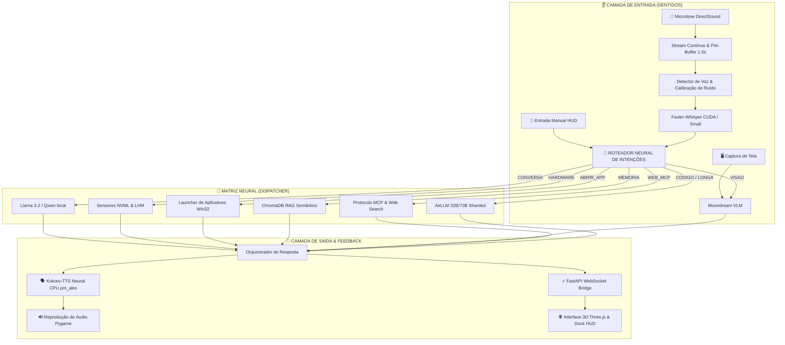

# ⚡ JARVIS - Núcleo de Inteligência Artificial Local & Sensorial
### 🏛️ STARK INDUSTRIES ARCHITECTURE | VERSÃO ALPHA 0.03

<div align="center">


<p align="center">
  <b>Um assistente pessoal inteligente, autônomo, 100% privado e local, inspirado no J.A.R.V.I.S. da ficção.</b><br>
  Equipado com audição contínua em tempo real, voz neural ultrarrápida, visão computacional de tela, memória vetorial semântica de longo prazo, telemetria física de hardware e interface holográfica 3D interativa.
</p>

</div>

---

## 🌌 A Ideia & Filosofia do Projeto

A maioria dos assistentes comerciais modernos sofre de três problemas fundamentais:
1. **Dependência Crítica da Nuvem**: Seus dados de voz, tela e perguntas pessoais são enviados para servidores de terceiros.
2. **Latência de Comunicação**: O tempo de espera entre você falar e o robô responder quebra a ilusão de uma conversa natural.
3. **Exigência de Supercomputadores para Modelos Grandes**: Modelos potentes de 32B ou 70B normalmente exigem estações industriais com dezenas de gigabytes de VRAM.

### 💡 A Solução do JARVIS Core:
O **JARVIS** foi arquitetado do zero para contornar esses gargalos com soluções de engenharia avançadas:
- **100% Local & Privado**: Nenhuma conversa, imagem da sua tela ou dado biométrico de voz sai da sua máquina.
- **Roteamento Neural Híbrido**: Respostas instantâneas para comandos comuns através de caminhos rápidos em Python/Regex e especialistas neurais dedicados para tarefas profundas.
- **Auto-Calibração de Hardware**: Identifica dinamicamente sua CPU, memória RAM e VRAM dedicada, ajustando o perfil operacional desde placas modestas (4 GB VRAM) até sistemas topo de linha.
- **Inferência Sharded (AirLLM)**: Capacidade de fatiar e rodar modelos massivos (como `Qwen 32B` e `72B`) camada por camada na memória secundária (SSD/HD), permitindo raciocínio de alta precisão em placas gráficas comuns.

---

## 🏛️ Arquitetura do Sistema



---

## 🚀 Funcionalidades Principais & Diferenciais Únicos

### 1. 👂 Audição Contínua em Tempo Real (Zero Latência)
- **Driver DirectSound Dedicado**: O Jarvis seleciona nativamente o driver DirectSound do Windows (`hostapi=1`), garantindo ganho de sinal até 10x maior que os drivers MME convencionais.
- **Pré-Buffer Circular Persistente (1.5s)**: Um buffer rotativo guarda os últimos 1.5 segundos de som. Quando você começa a falar, a primeira sílaba nunca é cortada.
- **Calibração Adaptativa de Ruído**: No boot, o sistema analisa o ruído da sala (ventoinhas, teclado) e ajusta dinamicamente a sensibilidade de corte.
- **Teto de Segurança & Botão Manual**: Trava automática de 8 segundos para evitar gravações infinitas e controle de parada instantâneo.

### 2. 🗣️ Síntese de Voz Neural Ultrarrápida (Kokoro-TTS)
- **Voz Local e Expressiva**: Utiliza a arquitetura neural **Kokoro-TTS** com pipeline em português brasileiro (`pm_alex`), gerando áudio natural e fluido em frações de segundo na CPU.
- **Filtro Anti-Eco**: Assim que a fala do assistente termina, o buffer do microfone é imediatamente higienizado (`limpar_pre_buffer()`), evitando que o Jarvis escute a própria voz através dos alto-falantes.
- **Rede de Segurança Tripla**: Se necessário, o Jarvis recorre automaticamente ao Edge-TTS (online) ou pyttsx3 (offline puro).

### 3. 🌐 Interface Holográfica 3D Reativa & Dock de Controle (Three.js)
- **Núcleo em Três Dimensões**: Uma esfera de partículas procedural inspirada no reator arc que pulsa, deforma e altera seu comportamento de acordo com a intensidade da fala e o tipo de tarefa executada.
- **Padrões de Movimento**:
  - 🔵 **Ciano Vivo (`conversa`)**: Esfera fluida e reativa, pronta para receber comandos.
  - 🟡 **Dourado (`hardware`)**: Rotação axial sincronizada para telemetria e sensores.
  - 🟣 **Violeta (`tarefa`)**: Padrão concentrado para processamento de código e visão.
  - 🔴 **Vermelho Alerta (`alerta`)**: Oscilação de alta frequência em caso de sobreaquecimento físico.
- **Painel Dock Flutuante**:
  - Botão **`[ ⏹️ PARAR E ENVIAR ]`**: Interrompe o microfone imediatamente e envia o áudio para o Whisper.
  - **Terminal de Comando por Texto**: Envio manual de solicitações sem necessidade de voz.

### 4. 🧠 Memória Semântica de Longo Prazo (RAG via ChromaDB)
- O Jarvis não esquece quem você é entre reinicializações.
- **Coleção de Fatos**: Armazena preferências, nomes, segredos, hábitos e parâmetros do usuário.
- **Histórico Conversacional**: Contexto temporal contínuo que enriquece os prompts com lembranças relevantes do passado usando busca vetorial por cosseno.

### 5. 🛡️ Sentinela Térmico & Telemetria Físico-Digital
- Monitoramento contínuo da GPU via **NVIDIA NVML** (temperatura, consumo elétrico em Watts, VRAM em uso) e sensores da placa-mãe/CPU via **LibreHardwareMonitor**.
- Proteção ativa: caso componentes excedam temperaturas seguras (85°C), o Jarvis emite alertas de voz com prioridade máxima para proteção dos circuitos.

### 6. 👁️ Olhos no seu Desktop (Visão Computacional)
- Integração com o modelo multimodal **Moondream (VLM)**.
- O Jarvis tira prints silenciosos sob demanda, inspeciona códigos com erros na sua tela, descreve imagens, reconhece janelas ativas e ajuda a depurar bugs diretamente no seu editor.

### 7. 🔌 Protocolo MCP (Model Context Protocol) & Conexão Web
- Conexão padronizada para servidores de ferramentas e buscas na internet em tempo real (notícias, cotações financeiras, documentações e previsões meteorológicas).

---

## 📂 Estrutura do Repositório

```plaintext
Meu_agente_de_IA/
├── DADOS/                        # Persistência de banco de dados e configs locais
│   ├── config_paths.json         # Diretórios configurados de SSD e HD
│   ├── model_registry.json       # Registro de especialistas e perfis de hardware
│   └── mcp_servers.json          # Configurações de servidores Model Context Protocol
├── INTERFACE/                    # Frontend holográfico e servidor visual
│   ├── index.html                # Visualizador Three.js e Dashboard HUD
│   ├── style.css                 # Estilização sci-fi glassmorphism
│   └── app.js                    # Motor gráfico da esfera de partículas e WebSocket
├── MODULOS/                      # Núcleo modular do agente
│   ├── brain/                    # Tomada de decisão, conversação e RAG
│   │   ├── core/router.py        # Roteador neural de intenções
│   │   ├── core/conversation.py  # Gerador de diálogo contextual
│   │   ├── memory/handler.py     # Classificador semântico de memórias
│   │   └── selector/             # Seletor automático de perfil de hardware
│   ├── ear/                      # Audição e transcrição
│   │   ├── recorder.py           # Captura DirectSound com pré-buffer e anti-ruído
│   │   ├── transcriber.py        # Faster-Whisper Small CUDA
│   │   └── states.py             # Máquina de estados do microfone
│   ├── voice/                    # Síntese vocal
│   │   ├── kokoro_tts_module.py  # Síntese neural local Kokoro (pt-BR)
│   │   └── voice_manager.py      # Fila de prioridades e fallbacks
│   ├── skills/                   # Habilidades ativas
│   │   ├── hardware_module.py    # Leitura de sensores (NVML/LHM) e Sentinela
│   │   ├── vision_module.py      # Análise de tela via Moondream
│   │   ├── actions_module.py     # Execução de comandos do Windows
│   │   ├── fii_monitor.py        # Monitor de mercado financeiro
│   │   └── mcp_client.py         # Cliente MCP para internet e ferramentas
│   ├── memory/                   # Banco vetorial ChromaDB persistente
│   └── system/                   # Infraestrutura, logs e sincronização
├── TESTES/                       # Suíte de testes unitários e diagnósticos
├── main.py                       # Orquestrador mestre e loop de vida do Jarvis
├── requirements.txt              # Dependências do ecossistema
└── README.md                     # Documentação oficial do projeto
```

---

## 🛠️ Como Instalar e Rodar

### 📋 Pré-requisitos
- **Sistema Operacional**: Windows 10 ou 11 (64-bit).
- **Python**: Versão `3.11.x` recomendada.
- **Ollama**: Instalado e rodando localmente ([ollama.com](https://ollama.com)).
  - Baixe os modelos recomendados no terminal:
    ```bash
    ollama pull llama3.2:3b
    ollama pull qwen2.5:1.5b
    ollama pull moondream
    ```
- **Placa de Vídeo**: Recomendado GPU NVIDIA com drivers CUDA atualizados (opera também via CPU com quantização).

### ⚙️ Instalação Passo a Passo

1. **Clone o repositório:**
   ```bash
   git clone https://github.com/Felipe-Roberto-Bacchi/Meu_agente_de_IA.git
   cd Meu_agente_de_IA
   ```

2. **Crie e ative um ambiente virtual (recomendado):**
   ```bash
   python -m venv venv
   .\venv\Scripts\activate
   ```

3. **Instale as dependências:**
   ```bash
   pip install -r requirements.txt
   ```

4. **Inicie o JARVIS:**
   ```bash
   python main.py
   ```

5. **Acesso à Interface:**
   - O assistente abrirá automaticamente a interface holográfica no seu navegador padrão em:
     **`http://localhost:8000`**

---

## 🗣️ Exemplos de Comandos (Voz ou Texto)

| Objetivo | O que você pode dizer ou digitar | O que o Jarvis faz |
| :--- | :--- | :--- |
| **Conversa Geral** | *"Olá Jarvis, como estão seus sistemas hoje?"* | Gera uma resposta natural contextualizada via Llama 3.2. |
| **Telemetria de PC** | *"Como estão as temperaturas da máquina?"* | Lê os sensores da GPU (NVML) e CPU em tempo real e relata graus e consumo. |
| **Visão de Tela** | *"Dá uma olhada na minha tela e me diga o que vê."* | Tira um snapshot invisível e analisa o conteúdo via Moondream VLM. |
| **Memória Contínua** | *"Jarvis, lembre que a senha do alarme é 4092."* | Grava o fato semanticamente no ChromaDB para uso futuro. |
| **Resgate de Fato** | *"Você sabe qual é a senha do alarme?"* | Realiza uma busca vetorial nas suas memórias e responde precisamente. |
| **Mercado Financeiro** | *"Como está o mercado de fundos imobiliários hoje?"* | Consulta dados consolidados de FIIs e resume oportunidades. |
| **Abrir Aplicativos** | *"Abre o Spotify para mim."* | Localiza o executável em cache e inicia o programa no Windows. |
| **Parada Manual** | Clique no botão **`[ ⏹️ PARAR E ENVIAR ]`** | Corta o áudio instantaneamente e processa o que você acabou de falar. |

---

## 📌 Histórico de Versões & Marcos Recentes

- **v0.01 (Nascimento do Núcleo)**:
  - Estruturação da arquitetura modular, ChromaDB e loop básico com Whisper.
- **v0.02 (Multimodalidade & Three.js)**:
  - Adição do analisador visual Moondream, servidor FastAPI e visualizador 3D reativo.
- **v0.03 - Alpha Atual (Estabilidade, Fala & HUD)**:
  - ✨ Migração definitiva para o **Kokoro-TTS** com voz neural local em português.
  - 🎤 Integração do driver **DirectSound** para o microfone com ganho 10x maior e zero atraso.
  - 🖥️ Novo **Dock de Controle Flutuante** no HUD com botão neon de parada e caixa de entrada manual.
  - 🛡️ Correção do falso positivo térmico no Sentinela de Hardware.
  - 🧼 Higienização do pré-buffer de microfone contra eco pós-fala.

---

## 👨‍💻 Autor & Direitos

Desenvolvido com dedicação por **Felipe Roberto Bacchi**.  
Inspirado na ficção científica, na engenharia de computação moderna e na busca por uma inteligência artificial verdadeiramente livre, útil e pessoal.

---

<div align="center">
  <i>"Às vezes, é preciso correr antes de conseguir andar." — Tony Stark</i>
</div>
