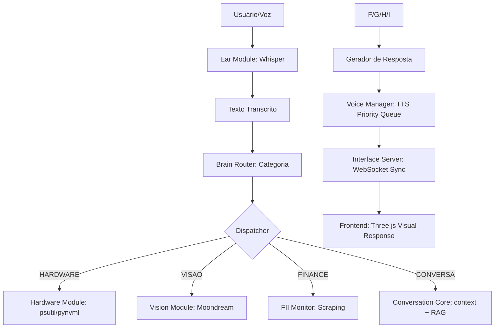

# 📋 PROJETO JARVIS: CONTEXTO PARA IA (BLUEPRINT)

Este documento condensa o conhecimento técnico do projeto para que outros agentes de IA possam entender a estrutura, a lógica e estender as funcionalidades sem necessidade de análise prévia exaustiva.

---

## 1. RESUMO EXECUTIVO
**Objetivo**: Assistente pessoal local multimodal (Voz, Visão, Monitoramento).
**Stack**: Python 3.10+, FastAPI (Bridge), WebSocket, Ollama (Inteligência), Whisper (STT), Qwen/Edge (TTS), ChromaDB (RAG).

---

## 2. MAPEAMENTO DE FLUXO (PIPELINE)


---

## 3. ARQUIVOS E RESPONSABILIDADES

### ⚡ CORE & BOOT
- `main.py`: Loop principal `asyncio`, inicia `voice_manager.processador_de_fala` e `interface_server`.
- `MODULOS/brain/__init__.py`: Ponto de entrada da decisão. Função `processar_comando(texto)`.

### 🧠 CÉREBRO (Camada de Decisão)
- `MODULOS/brain/core/router.py`: Categorizador de intenção. Usa regex/keywords (fallback) e LLM.
- `MODULOS/brain/core/conversation.py`: Interface com Ollama. Injeta histórico e fatos (RAG).
- `MODULOS/brain/core/executor.py`: Planejador de tarefas complexas em background.
- `MODULOS/brain/memory/handler.py`: Classificador de ações de memória via LLM (Salvar/Buscar/Apagar).
- `MODULOS/memory_long.py`: Interface ChromaDB. `salvar_memoria`, `buscar_memoria` (semântica).
- `MODULOS/nlp_processor.py`: Normalizador fonético que limpa transcrições do Whisper antes do roteamento.

### 👂 SENTIDOS (Camada Sensorial)
- `MODULOS/ear/`: Sistema de áudio circular com estados (Dormindo/Ativo).
- `MODULOS/vision_module.py`: Captura e análise visual via Moondream (Ollama).
- `MODULOS/identity_module.py`: Motor de auto-detecção que gera o perfil de hardware local (`jarvis_identity.json`).

### 📢 FEEDBACK E MONITORAMENTO (Camada de Resposta)
- `MODULOS/voice_manager.py`: Fila de prioridades para TTS (Qwen/Edge/Local).
- `MODULOS/hardware_module.py`: Monitor de sensores (CPU/GPU) usando NVML e binários do `monitor/`.
- `MODULOS/interface_server.py`: Bridge WebSocket para a UI 3D.

---

## 📊 SCHEMAS DE DADOS

### Configuração (`DADOS/config_paths.json`)
```json
{
  "ssd_path": "C:/...",
  "hd_path": "D:/...",
  "current_perfil": "HIGH_END"
}
```

### Memória Semântica (ChromaDB)
- **Collection "fatos"**: `{ "chave": "nome", "valor": "Felipe" }`.
- **Collection "historico"**: Mensagens raw com metadados de `papel` e `timestamp`.

---

## 🛠️ EXTENSÃO E PADRÕES DE CODIFICAÇÃO
- **Simultaneidade**: Use `asyncio` e `loop.run_in_executor` para tarefas pesadas (Ollama/TTS) para não travar o loop de áudio.
- **Segurança**: Antes de qualquer ação física/longa, verifique o `hardware_module.py` para alertas térmicos.
- **Interface**: Toda resposta deve enviar um `update` via `interface_server` para sincronizar a animação do Orb (cores: Cyan=Conversa, Verde=App, Vermelho=Alerta).

---
*Este Blueprint deve ser lido integralmente antes de propor alterações na lógica de roteamento ou de memória do Jarvis.*
